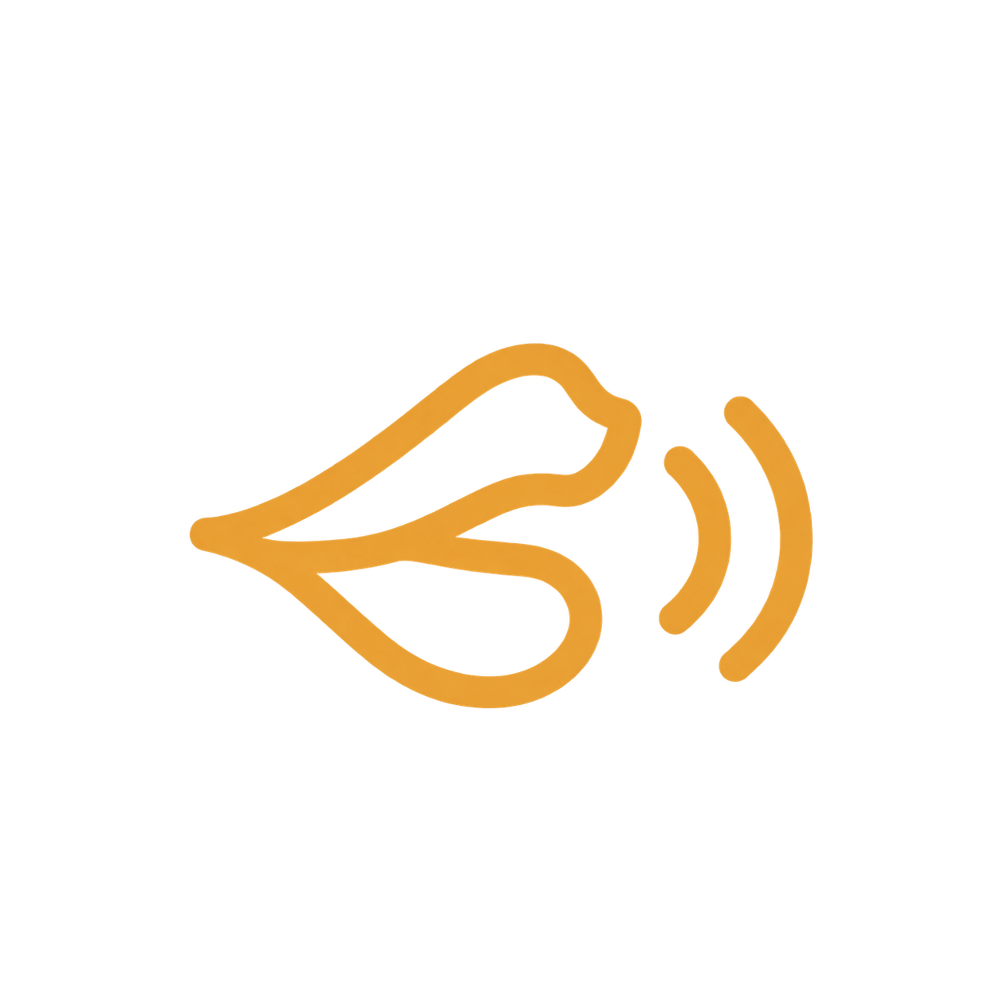
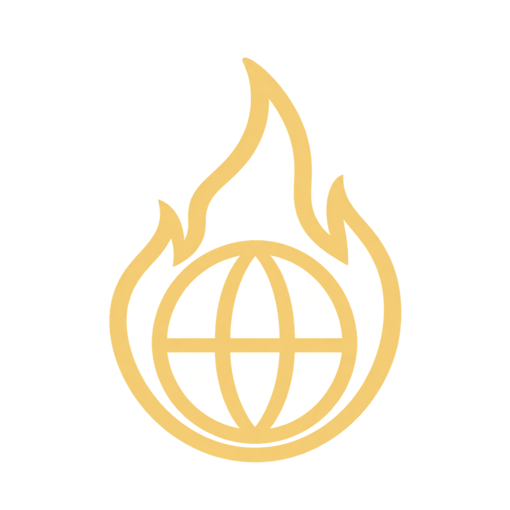

# Proposed Logos symbols

Four simple pictograms for the Chthonic Logos rites, replacing abstract planetary and star glyphs
with the action each rite evokes. These are asset proposals; the current panel is not wired to them.

| Rite       | Proposed symbol                                                                                | Meaning                                                            |
| ---------- | ---------------------------------------------------------------------------------------------- | ------------------------------------------------------------------ |
| Suggestion |       | Parted lips and two sound strokes: a word planted in another mind. |
| Logismoi   |            | A spiral inside a head: intrusive thoughts taking root.            |
| Imperium   |  | A crown and downward arrow: authority imposing its will.           |
| Panvitium  |              | A burning world: the sins unleashed on earth.                      |

## Asset details

- Individual 1254 × 1254 RGBA PNGs with transparent backgrounds and built-in padding.
- Amber gold for Suggestion and Logismoi; pale gold for Imperium and Panvitium.
- Suggested starting size: a 64 × 64 image box centered in the existing 96 × 96 sigil.
- Keep the existing rings, progress arc, and active glow in CSS; they are not baked into the images.
- Serve from `/assets/panvitium/logos-symbols-proposed/<rite>.png`.

Created with OpenAI image generation for this proposal. The filenames match the canonical rite IDs.
